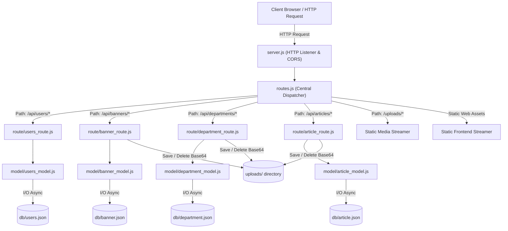

# Backend Infrastructure & REST API Server

Dokumentasi infrastruktur, arsitektur teknis, dan spesifikasi REST API untuk subsistem **Backend** aplikasi **PNJ Official Portal & Admin Dashboard**.

---

## 📋 Daftar Isi
1. [Gambaran Umum](#-gambaran-umum)
2. [Arsitektur & Prinsip Desain](#-arsitektur--prinsip-desain)
3. [Infrastruktur Inti (Core Components)](#-infrastruktur-inti-core-components)
4. [Sistem Basis Data (JSON-DB Engine)](#-sistem-basis-data-json-db-engine)
5. [Sub-Sistem Pengunggahan Berkas (Media & File Storage)](#-sub-sistem-pengunggahan-berkas-media--file-storage)
6. [Struktur Direktori](#-struktur-direktori)
7. [Spesifikasi REST API Endpoints](#-spesifikasi-rest-api-endpoints)
8. [Panduan Menjalankan & Konfigurasi](#-panduan-menjalankan--konfigurasi)

---

## 🔭 Gambaran Umum

Layanan backend ini dirancang dengan prinsip **Zero External Framework**, dibangun murni menggunakan modul-modul bawaan (**native**) Node.js (`http`, `fs/promises`, `path`, `crypto`, `url`). Subsistem ini bertindak sebagai:
- **RESTful API Engine**: Menyediakan antarmuka komunikasi data untuk entitas Artikel, Banner Slider, Departemen/Program Studi, dan Autentikasi Pengguna.
- **Embedded Static File Server**: Menyajikan berkas media yang diunggah (`/uploads/`) serta dapat menyajikan berkas antarmuka frontend (`/frontend/` atau root portal) secara langsung dari server HTTP yang sama.
- **Lightweight Document Store**: Mengelola persistensi data menggunakan file JSON terstruktur (*Mimic Database*) tanpa memerlukan konfigurasi Database Management System (DBMS) eksternal seperti MySQL atau MongoDB.

---

## 🏛️ Arsitektur & Prinsip Desain

Arsitektur backend memisahkan tanggung jawab sistem menjadi beberapa lapisan modular:



### Prinsip Utama:
1. **Native Modularity**: Seluruh kode ditulis menggunakan standar **ECMAScript Modules (ESM)** dengan deklarasi `"type": "module"` pada `package.json`.
2. **Layered Decoupling**: Pemisahan tegas antara Server Entrypoint (`server.js`), Central Routing & Utility (`routes.js`), Feature Sub-routers (`route/`), Data Access Models (`model/`), dan Storage (`db/` & `uploads/`).
3. **Non-blocking Asynchronous I/O**: Semua operasi baca/tulis berkas dilakukan secara asinkron menggunakan modul `fs/promises`.
4. **Security by Default**: Password pengguna disimpan menggunakan kriptografi *hashing* satu arah (SHA-256), dan atribut sensitif seperti password disanitasi dari seluruh output response API.

---

## ⚙️ Infrastruktur Inti (Core Components)

### 1. HTTP Server & CORS Management (`server.js`)
Berkas `server.js` merupakan titik masuk (*entry point*) aplikasi backend:
- **Port Binding**: Mendengarkan pada `process.env.PORT` atau default port `3000`.
- **CORS Handling**: Menetapkan header response secara global:
  - `Access-Control-Allow-Origin: *`
  - `Access-Control-Allow-Methods: GET, POST, PUT, DELETE, OPTIONS`
  - `Access-Control-Allow-Headers: Content-Type, Authorization`
- **Preflight Interceptor**: Menangani request metode `OPTIONS` dengan langsung merespons status `204 No Content`, memastikan komunikasi lintas origin dari browser berjalan mulus.
- **Bootstrapping**: Memanggil `initDb()` secara otomatis sebelum server mulai menerima request.

### 2. Central Router & Helper Functions (`routes.js`)
Berkas `routes.js` bertindak sebagai *traffic controller* dan penyedia utilitas umum:
- **`jsonResponse(res, statusCode, payload)`**: Helper untuk membakukan format respons JSON, menyematkan header `Content-Type: application/json`, dan mengakhiri stream respons.
- **`getRequestBody(req)`**: Utilitas stream reader berbasis Promise untuk mengonsumsi chunk data request `POST`/`PUT` dan mem-parsingnya ke objek JSON valid.
- **Sub-Router Dispatching**: Mengalirkan request ke handler fitur (`handleUserRoutes`, `handleBannerRoutes`, `handleDepartmentRoutes`, `handleArticleRoutes`). Jika sebuah sub-router menangani request, handler mengembalikan `true`.
- **Static File Serving (`/uploads/`)**: Menyajikan berkas biner media dari direktori `backend/uploads/` dengan pemetaan MIME type otomatis:
  - `.jpg`, `.jpeg` $\rightarrow$ `image/jpeg`
  - `.png` $\rightarrow$ `image/png`
  - `.gif` $\rightarrow$ `image/gif`
  - `.svg` $\rightarrow$ `image/svg+xml`
- **Frontend File Serving**: Menyajikan berkas antarmuka frontend jika backend dijalankan sebagai server monolitik, mendukung tipe MIME `.html`, `.js`, `.css`, `.jpg`, `.png`, `.gif`, `.svg`, dan `.ico`.
- **Health Check (`GET /api/health`)**: Endpoint untuk verifikasi kesiapan server (*uptime check*).

### 3. Modular Feature Routes (`route/`)
Setiap modul di direktori `route/` mengisolasi endpoint per domain bisnis:
- **`article_route.js`**: Menangani daftar artikel, detail via ID atau slug, pembuatan artikel baru (dengan parsing base64 thumbnail), pembaruan data & thumbnail, penambahan counter pembaca (`/api/articles/view`), serta penghapusan data & berkas gambar lama.
- **`banner_route.js`**: Menangani manipulasi banner carousel (title, subtitle, URL, urutan/order, status aktif, dan unggah gambar).
- **`department_route.js`**: Menangani manajemen departemen kampus, daftar program studi per departemen, dan unggahan logo/gambar departemen.
- **`users_route.js`**: Menangani autentikasi login (`/api/users/login`) dengan verifikasi hash SHA-256, registrasi akun baru, pembaruan profil, dan penghapusan akun.

---

## 💾 Sistem Basis Data (JSON-DB Engine)

Persistensi data dilakukan dengan format file flat JSON di direktori `backend/db/`. Sistem ini dirancang tahan terhadap kondisi berkas yang belum ada melalui mekanisme *auto-initialization*:

### Inisialisasi Basis Data (`db.js`)
Fungsi `initDb()` memeriksa keberadaan folder `backend/uploads/` dan `backend/db/`. Jika salah satu atau kedua folder tersebut belum tersedia di lingkungan deployment, direktori akan dibuat otomatis dengan flag `{ recursive: true }`.

### Berkas Basis Data & Template Fallback
| Berkas Data | Berkas Template | Deskripsi Entitas |
| :--- | :--- | :--- |
| `db/article.json` | `article.json.template` | Menyimpan koleksi artikel berita, kategori, counter view, status publikasi, dan referensi thumbnail. |
| `db/banner.json` | `banner.json.template` | Menyimpan data banner slide untuk carousel landing page. |
| `db/department.json` | `department.json.template` | Menyimpan master data fakultas/jurusan dan daftar program studi terdaftar. |
| `db/users.json` | `users.json.template` | Menyimpan data akun pengguna dan administrator dengan password ter-hash. |

### Lapisan Model Data (`model/`)
Setiap berkas model mengabstraksikan operasi CRUD terhadap berkas JSON:
- **`initFile()`**: Menjamin file JSON ada. Jika belum ada, model akan membuat file baru dengan array kosong atau data default.
- **Auto ID Generator**: Menghasilkan ID unik berbasis waktu dan entropy acak (contoh: `art_1718000000000_abc12`, `ban_...`, `dept_...`, `usr_...`).
- **Auto Slugification (`article_model.js`)**: Mengubah judul artikel menjadi URL-friendly slug (contoh: `"Prestasi Mahasiswa PNJ"` $\rightarrow$ `"prestasi-mahasiswa-pnj"`).
- **Password Hashing (`users_model.js`)**:
  ```javascript
  export const hashPassword = (password) => {
    if (!password) return '';
    return crypto.createHash('sha256').update(password).digest('hex');
  };
  ```
- **Default Admin Seeding**: Jika `db/users.json` belum ada, model otomatis membuat akun admin default dengan username `admin` dan password `admin123` yang langsung di-hash.

---

## 🖼️ Sub-Sistem Pengunggahan Berkas (Media & File Storage)

Penyimpanan berkas media dirancang tanpa dependensi pustaka multipart pihak ketiga:

```
[Client] 
  │ 1. Kirim JSON Payload: { imageName: "foto.png", imageData: "data:image/png;base64,iVBORw..." }
  ▼
[route/*_route.js] 
  │ 2. Ekstrak header Base64: imageData.replace(/^data:image\/\w+;base64,/, '')
  │ 3. Buat nama berkas unik: article_${Date.now()}_${random}.${ext}
  │ 4. Tulis berkas biner ke backend/uploads/ via fs.writeFile(savePath, data, 'base64')
  │ 5. Hapus berkas lama jika operasi PUT mengganti gambar (fs.unlink)
  ▼
[Storage: backend/uploads/]
  │ 6. Disajikan ke klien melalui GET /uploads/{filename} via routes.js
```

### Fitur Manajemen Berkas Unggahan:
- **Sanitasi Base64**: Menghapus metadata prefix data URI sebelum penulisan berkas.
- **Pembersihan Otomatis (*Orphan Image Cleanup*)**: Saat artikel, banner, atau departemen diperbarui gambarnya atau dihapus, berkas gambar lama di direktori `uploads/` akan dihapus dari disk menggunakan `fs.unlink()` (kecuali gambar default/placeholder).

---

## 📂 Struktur Direktori

```text
backend/
├── db/                             # Direktori penyimpanan file database JSON lokal
│   ├── article.json                # Data aktif artikel & berita kampus
│   ├── article.json.template       # Template awal struktur data artikel
│   ├── banner.json                 # Data aktif slide banner landing page
│   ├── banner.json.template        # Template awal struktur data banner
│   ├── department.json             # Data aktif departemen & program studi
│   ├── department.json.template    # Template awal struktur data departemen
│   ├── users.json                  # Data akun pengguna (password terenkripsi SHA-256)
│   └── users.json.template         # Template akun admin default
├── model/                          # Data Access Layer (Operasi CRUD file JSON)
│   ├── article_model.js            # Model artikel, slugifier, dan views counter
│   ├── banner_model.js             # Model manajemen banner
│   ├── department_model.js         # Model departemen dan program studi
│   └── users_model.js              # Model pengguna & enkripsi password SHA-256
├── route/                          # Feature Sub-Routers
│   ├── article_route.js            # Controller & handler request artikel
│   ├── banner_route.js             # Controller & handler request banner
│   ├── department_route.js         # Controller & handler request departemen
│   └── users_route.js              # Controller & handler request pengguna & login
├── uploads/                        # Direktori penyimpanan berkas gambar statis
│   ├── noimage.jpg                 # Gambar fallback default
│   └── ...                         # Berkas biner hasil upload pengguna
├── db.js                           # Inisialisasi folder penyimpanan (db & uploads)
├── package.json                    # Konfigurasi package & scripts Node.js backend
├── routes.js                       # Central route dispatcher & static file server
└── server.js                       # Entry point aplikasi HTTP server Node.js
```

---

## 📡 Spesifikasi REST API Endpoints

Semua response API dibungkus dalam format JSON terstandar:
```json
{
  "status": "success" | "error",
  "message": "Deskripsi pesan (opsional)",
  "data": { ... } | [ ... ]
}
```

### 1. Sistem & Health Check
| Method | Endpoint | Deskripsi |
| :--- | :--- | :--- |
| `GET` | `/api/health` | Memeriksa status operasional server dan waktu server saat ini. |

---

### 2. Autentikasi & Pengguna (`/api/users`)

#### `POST /api/users/login`
Autentikasi kredensial pengguna.
- **Request Body**:
  ```json
  {
    "username": "admin",
    "password": "passwordAnda"
  }
  ```
- **Response `200 OK`**:
  ```json
  {
    "status": "success",
    "data": {
      "id": "usr_admin",
      "username": "admin",
      "name": "Administrator",
      "email": "admin@example.com",
      "role": "admin",
      "status": "active"
    },
    "message": "Login successful"
  }
  ```

#### `GET /api/users`
Mengambil semua pengguna (password otomatis disanitasi).
- **Query Parameter (Opsional)**: `?id={id}` untuk mendapatkan detail pengguna tunggal.

#### `POST /api/users`
Membuat pengguna baru (password otomatis dienkripsi dengan SHA-256).
- **Request Body**:
  ```json
  {
    "username": "dosen_ti",
    "password": "rahasiaPassword",
    "name": "Dosen Informatika",
    "email": "dosen@pnj.ac.id",
    "role": "editor"
  }
  ```

#### `PUT /api/users?id={id}`
Memperbarui profil atau password pengguna.

#### `DELETE /api/users?id={id}`
Menghapus pengguna berdasarkan ID.

---

### 3. Berita & Artikel (`/api/articles`)

#### `GET /api/articles`
Mendapatkan koleksi seluruh artikel berita.
- **Query Parameters (Opsional)**:
  - `?id={id}` : Mengambil satu artikel berdasarkan ID unik.
  - `?slug={slug}` : Mengambil satu artikel berdasarkan SEO slug.

#### `POST /api/articles`
Menambahkan artikel baru dan mengunggah gambar thumbnail (jika disertakan).
- **Request Body**:
  ```json
  {
    "title": "Prestasi Mahasiswa PNJ di Kompetisi Internasional",
    "type": "Prestasi",
    "date": "2026-06-11",
    "summary": "Mahasiswa Jurusan Teknik Informatika meraih juara 1...",
    "content": "<p>Konten lengkap artikel berita...</p>",
    "author": "Humas PNJ",
    "status": "published",
    "imageName": "juara.jpg",
    "imageData": "data:image/jpeg;base64,/9j/4AAQSkZJRg..."
  }
  ```

#### `PUT /api/articles?id={id}`
Memperbarui data artikel yang ada. Jika menyertakan `imageData` baru, thumbnail lama akan digantikan dan berkas lama dihapus dari disk.

#### `POST /api/articles/view?id={id}`
Menaikkan (*increment*) jumlah pembaca (*view counter*) artikel secara realtime.

#### `DELETE /api/articles?id={id}`
Menghapus artikel dari basis data dan menghapus berkas thumbnail fisik dari disk.

---

### 4. Banner Carousel (`/api/banners`)

#### `GET /api/banners`
Mendapatkan semua slide banner yang tersimpan, diurutkan berdasarkan field `order`.

#### `POST /api/banners`
Menambahkan slide banner baru.
- **Request Body**:
  ```json
  {
    "title": "Penerimaan Mahasiswa Baru 2026/2027",
    "subtitle": "Bergabunglah bersama Politeknik Negeri Jakarta",
    "linkUrl": "#pendaftaran",
    "order": 1,
    "isActive": true,
    "imageName": "banner1.jpg",
    "imageData": "data:image/jpeg;base64,..."
  }
  ```

#### `PUT /api/banners?id={id}`
Memperbarui teks, urutan, status aktif, atau gambar slide banner.

#### `DELETE /api/banners?id={id}`
Menghapus slide banner dan menghapus berkas gambarnya dari disk.

---

### 5. Departemen & Program Studi (`/api/departments`)

#### `GET /api/departments`
Mendapatkan seluruh daftar departemen kampus beserta program studinya.

#### `POST /api/departments`
Menambahkan departemen baru.
- **Request Body**:
  ```json
  {
    "department_name": "Teknik Informatika dan Komputer",
    "department_study_program": [
      "Teknik Informatika (D4)",
      "Teknik Multimedia Digital (D4)",
      "Teknik Komputer dan Jaringan (D1)"
    ],
    "imageName": "tik.png",
    "imageData": "data:image/png;base64,..."
  }
  ```

#### `PUT /api/departments?id={id}`
Mengubah nama departemen, daftar program studi, atau gambar departemen.

#### `DELETE /api/departments?id={id}`
Menghapus departemen dan gambar terkait.

---

### 6. Akses Berkas Statis Unggahan (`/uploads`)

| Method | Endpoint | Deskripsi |
| :--- | :--- | :--- |
| `GET` | `/uploads/{filename}` | Mengunduh atau menampilkan berkas gambar publik yang tersimpan di `backend/uploads/`. |

---

## 🚀 Panduan Menjalankan & Konfigurasi

### Kebutuhan Sistem
- **Node.js**: Versi `16.0.0` atau lebih baru.
- **NPM**: Bawaan Node.js (hanya digunakan sebagai task runner skrip).

### Menjalankan Server
Masuk ke direktori utama repositori atau direktori `backend/`:

```bash
# Menjalankan dari root repositori:
npm start

# Atau menjalankan langsung dari direktori backend/:
cd backend
node server.js
```

### Variabel Lingkungan (*Environment Variables*)
| Variabel | Tipe | Nilai Default | Deskripsi |
| :--- | :--- | :--- | :--- |
| `PORT` | Integer | `3000` | Port tempat HTTP server mendengarkan koneksi masuk. |

Contoh menjalankan pada port kustom:
```bash
PORT=8080 node backend/server.js
```
