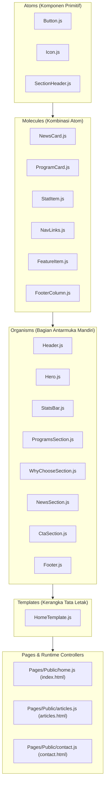
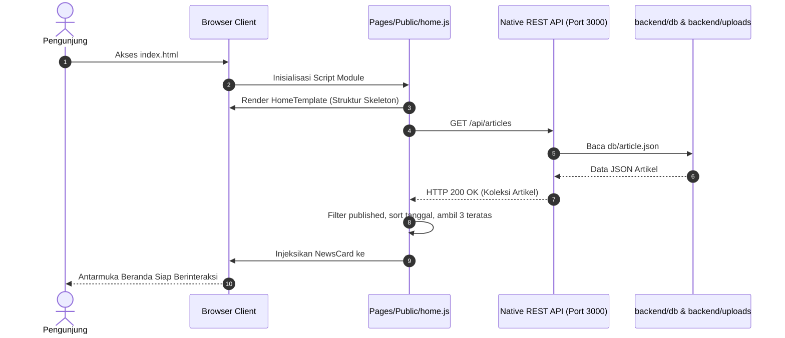

# Frontend Infrastructure & Atomic Design System

Dokumentasi arsitektur, metodologi **Atomic Design**, sistem desain antarmuka, dan integrasi API untuk subsistem **Frontend** aplikasi **PNJ Official Portal & Admin Dashboard**.

---

## 📋 Daftar Isi
1. [Gambaran Umum](#-gambaran-umum)
2. [Metodologi Arsitektur: Atomic Design](#-metodologi-arsitektur-atomic-design)
3. [Rincian Komponen Komprehensif](#-rincian-komponen-komprehensif)
4. [Pengendali Halaman Dinamis (Pages Controller)](#-pengendali-halaman-dinamis-pages-controller)
5. [Sistem Desain & Tipografi (Tailwind CSS)](#-sistem-desain--tipografi-tailwind-css)
6. [Alur Komunikasi API & Data Flow](#-alur-komunikasi-api--data-flow)
7. [Struktur Direktori](#-struktur-direktori)
8. [Panduan Menjalankan & Pengembangan](#-panduan-menjalankan--pengembangan)

---

## 🔭 Gambaran Umum

Subsistem Frontend portal resmi **Politeknik Negeri Jakarta (PNJ)** dibangun menggunakan **Modern Vanilla JavaScript** dengan standar **ECMAScript Modules (ESM)** tanpa dependensi pustaka komponen berat (seperti React, Vue, atau Angular) dan tanpa proses *bundling* (*Zero-Build Workflow*).

### Karakteristik Kunci:
- **Modul Standar ES6+**: Setiap komponen didefinisikan sebagai fungsi murni (*pure template function*) yang menghasilkan string HTML terstruktur dan diekspor menggunakan sintaks `export`.
- **Atomic Design Pattern**: Arsitektur komponen terbagi secara hierarkis menjadi *Atoms*, *Molecules*, *Organisms*, dan *Templates* guna menjamin skalabilitas dan *reusability*.
- **Tailwind CSS via CDN**: Styling utilitas modern diperluas dengan konfigurasi kustom berbasis **Material Design 3 Design Tokens**.
- **Dynamic Asynchronous Rendering**: Data konten seperti berita kampus dan statistik diambil secara asinkron dari backend REST API menggunakan `fetch` API.

---

## 🏛️ Metodologi Arsitektur: Atomic Design

Penerapan metodologi **Atomic Design** pada frontend ini membagi antarmuka pengguna ke dalam 5 tingkatan hierarki:



---

## 🧩 Rincian Komponen Komprehensif

### 1. Atoms (`Components/Atomic/Atoms/`)
Elemen antarmuka paling mendasar yang tidak dapat dipecah lagi tanpa kehilangan fungsi intinya:
- **`Button.js`**:
  - Menghasilkan elemen `<button>` atau tautan `<a>` tergantung ada/tidaknya properti `href`.
  - Mendukung varian tampilan: `primary`, `secondary`, `outline`, `outlineLight`, dan `ghost`.
  - Mendukung penyematan ikon (*icon prefix/suffix*) melalui integrasi dengan `Icon.js`.
- **`Icon.js`**:
  - Mengabstraksikan rendering simbol dari pustaka **Google Material Symbols Outlined**.
  - Mendukung penyesuaian ukuran font, warna, dan deklarasi CSS font variation (`FILL`).
- **`SectionHeader.js`**:
  - Komponen judul bagian standar dengan badge/aksen *eyebrow* di bagian atas dan judul teks berukuran besar (*display/headline*).

### 2. Molecules (`Components/Atomic/Molecules/`)
Kombinasi dua atau lebih atom yang bekerja bersama sebagai satu unit fungsional:
- **`NewsCard.js`**:
  - Kartu ringkasan artikel yang memadukan thumbnail gambar, badge kategori/tag, tanggal terbit, judul berita, cuplikan ringkasan, serta tombol navigasi baca artikel.
- **`ProgramCard.js`**:
  - Kartu representasi departemen kampus yang menampilkan ikon bidang keilmuan, badge kategori (Engineering, Construction, Media, Technology, Management, Finance), judul departemen, deskripsi kurikulum, dan banner visual jurusan.
- **`StatItem.js`**:
  - Blok metrik pencapaian kampus yang menggabungkan angka statistik berukuran besar dengan teks penjelasan.
- **`NavLinks.js`**:
  - Menghasilkan daftar tautan navigasi bilah menu (`<nav>`) dengan efek transisi hover interaktif.
- **`FeatureItem.js`**:
  - Menampilkan poin keunggulan institusi berupa ikon dalam kontainer melingkar beserta judul dan keterangan singkat.
- **`FooterColumn.js`**:
  - Menghasilkan kolom navigasi tautan vertikal untuk area footer.

### 3. Organisms (`Components/Atomic/Organisms/`)
Kumpulan molekul dan atom yang membentuk bagian fungsional utuh dari sebuah halaman web:
- **`Header.js`**:
  - Bilah navigasi *sticky* di bagian atas layar dengan efek *backdrop blur* transparan.
  - Memuat logo resmi PNJ, navigasi desktop, tombol kontak, tombol pemicu menu responsif (*hamburger button*), dan *mobile navigation dropdown*.
- **`Hero.js`**:
  - Bagian banner selamat datang utama dengan latar belakang foto kampus (`/assets/images/put.png`), lapisan *hero gradient* gelap, badge "Akreditasi Unggul", heading utama, serta aksi cepat pendaftaran dan eksplorasi prodi.
- **`StatsBar.js`**:
  - Bagian sorotan angka statistik kampus (mahasiswa aktif, serapan kerja lulusan, akreditasi BAN-PT, total program studi).
- **`ProgramsSection.js`**:
  - Katalog departemen dan program studi vokasi yang menampilkan 7 jurusan utama di PNJ:
    1. *Teknik Mesin*
    2. *Teknik Sipil*
    3. *Teknik Informatika*
    4. *Teknik Elektro*
    5. *Teknik Grafika dan Penerbitan (TGP)*
    6. *Administrasi Niaga*
    7. *Akuntansi*
- **`WhyChooseSection.js`**:
  - Bagian yang menyoroti 4 pilar keunggulan vokasi terapan (Kurikulum Berbasis Industri, Sertifikasi Kompetensi, Fasilitas Bengkel/Lab Modern, Jaringan Kerja Sama Luas).
- **`NewsSection.js`**:
  - Bagian beranda yang memuat kontainer `#news-grid` untuk penyuntikan dinamis kartu berita terbaru dari backend REST API.
- **`CtaSection.js`**:
  - Bagian ajakan aksi pendaftaran mahasiswa baru dilengkapi **Tabel Jadwal Seleksi PMB** (SNBP Prestasi, UTBK-SNBT, Mandiri Politeknik PNJ) serta status aktif seleksi.
- **`Footer.js`**:
  - Bagian penutup halaman berisi alamat kampus Politeknik Negeri Jakarta di Kampus UI Depok, tautan media sosial, kontak resmi, dan hak cipta (*copyright*).

### 4. Templates (`Components/Atomic/Templates/`)
- **`HomeTemplate.js`**:
  - Merangkai seluruh organisme halaman beranda ke dalam struktur tata letak satu halaman:
    ```javascript
    export const homeTemplate = () => `
      ${header()}
      <main>
        ${hero()}
        ${statsBar()}
        ${programsSection()}
        ${whyChooseSection()}
        ${newsSection()}
        ${ctaSection()}
      </main>
      ${footer()}
    `;
    ```

---

## 🎮 Pengendali Halaman Dinamis (Pages Controller)

Lapisan pengendali (*controller*) bertugas menghubungkan HTML statis dengan template modular dan data asinkron dari backend REST API:

### 1. Beranda (`frontend/Pages/Public/home.js`)
- Menginjeksikan `homeTemplate()` ke dalam kontainer `#app` pada `index.html`.
- Melakukan pemanggilan asinkron ke `GET http://localhost:3000/api/articles`.
- Memfilter artikel yang berstatus `published`, mengurutkannya berdasarkan tanggal terbaru, dan mengambil 3 artikel pertama.
- Memformat tanggal ke standar lokal Indonesia (`Intl.DateTimeFormat('id-ID')`).
- Menyuntikkan kartu berita (`newsCard`) ke elemen `#news-grid`.
- Mengatur event listener navigasi mobile (*hamburger toggle*) dan *smooth scrolling* dengan *offset compensation* sebesar `96px` agar tidak tertutup header sticky.

### 2. Portal Berita & Artikel (`frontend/Pages/Public/articles.js`)
- Mengendalikan fungsionalitas penuh halaman `articles.html`:
  - **Pencarian Realtime dengan Debounce**: Filter berdasarkan judul, ringkasan, dan konten dengan penundaan `300ms`.
  - **Filter Kategori**: Mendukung klasifikasi `all`, `berita`, `pengumuman`, `prestasi`, `agenda`, dan `liputan`.
  - **Sorting Interaktif**: Opsi pengurutan berdasarkan `most-viewed` (populer/paling banyak dibaca), `newest` (terbaru), dan `oldest` (terlama).
  - **Modal Pop-up Pembaca Berita**: Modal baca artikel lengkap tanpa *page reload*.
  - **Realtime View Counter**: Setiap kali modal artikel dibuka, controller mengirimkan request `POST /api/articles/view?id={id}` ke backend untuk menaikkan counter pembaca secara instan.

### 3. Formulir Kontak Akademik (`frontend/Pages/Public/contact.js`)
- Mengendalikan halaman `contact.html`:
  - Merender struktur halaman kontak dengan header dan footer resmi.
  - **Validasi Input Sisi Klien**:
    - Nama lengkap wajib diisi.
    - Format email diperiksa menggunakan Regular Expression (RFC compliant).
    - Nomor telepon divalidasi khusus format nomor Indonesia (diawali `08` atau `+62` dengan panjang 10–14 karakter).
    - Subjek dan isi pesan wajib diisi minimal panjang tertentu.
  - Menampilkan indikator pesan sukses atau peringatan error secara dinamis tanpa me-refresh halaman.

### 4. Admin Dashboard & Login (`frontend/Pages/Admin/` & `login.html`)
- Mengakomodasi kebutuhan pengelolaan konten kampus, otentikasi login administrator, dan dashboard manajemen artikel.

---

## 🎨 Sistem Desain & Tipografi (Tailwind CSS)

Antarmuka didesain menggunakan panduan warna modern **Material Design 3 (M3)** yang dikonfigurasi melalui objek skrip `tailwind.config` di dalam berkas HTML:

### Palet Warna Utama
| Token Warna | Nilai Hex | Peran / Penggunaan |
| :--- | :--- | :--- |
| `primary` | `#00676a` | Warna brand utama (Teal gelap resmi), header tombol, dan ikon aktif |
| `primary-container`| `#128285` | Warna penampung elemen primer dan kartu sorotan |
| `primary-fixed` | `#95f2f4` | Warna aksen cerah untuk kontras tinggi pada latar gelap |
| `secondary` | `#785900` | Warna sekunder (emas/amber) untuk aksen prestasi & akreditasi |
| `secondary-container`| `#fdc003` | Warna badge akreditasi dan tombol peringatan |
| `background` | `#f9f9fc` | Latar belakang dasar halaman (*soft light*) |
| `surface-container-lowest` | `#ffffff` | Latar kartu putih bersih (*cards surface*) |
| `surface-container` | `#eeeef0` | Latar kontainer bertingkat |
| `on-surface` | `#1a1c1e` | Warna teks utama untuk keterbacaan optimal |
| `on-surface-variant`| `#3e4949` | Warna teks pendukung / deskripsi / tanggal |
| `outline-variant` | `#bdc9c9` | Garis pembatas border tipis |

### Spacing & Layout Tokens
- `container-margin-desktop`: `40px`
- `container-margin-mobile`: `16px`
- `card-padding`: `24px`
- `section-gap`: `48px`
- `gutter`: `24px`

### Tipografi
- **Headings / Judul**: Font **Manrope** (bobot 600, 700, 800) untuk kesan modern dan berwibawa.
- **Body / Konten**: Font **Inter** (bobot 400, 500, 600) untuk kenyamanan membaca teks panjang.
- **Ikonografi**: **Google Material Symbols Outlined**.

---

## 🔄 Alur Komunikasi API & Data Flow



---

## 📂 Struktur Direktori

```text
frontend/
├── assets/                         # Aset statis frontend
│   └── images/                     # Direktori gambar dan ikon
│       ├── jurusan/                # Foto per departemen kampus
│       │   ├── Administrasi Niaga.jpg
│       │   ├── Akuntansi.jpg
│       │   ├── Teknik Elektro.jpg
│       │   ├── Teknik Grafika Penerbitan.jpg
│       │   ├── Teknik Informatika.png
│       │   ├── Teknik Mesin.png
│       │   └── Teknik Sipil.png
│       ├── logo.png                # Logo resmi Politeknik Negeri Jakarta
│       └── put.png                 # Banner utama kampus PNJ
├── Components/                     # Komponen modular antarmuka
│   ├── Admin/                      # Komponen antarmuka panel admin
│   │   └── ArticleAddModal.html    # Template modal tambah/edit artikel
│   └── Atomic/                     # Struktur hierarkis Atomic Design
│       ├── Atoms/                  # Komponen primitif
│       │   ├── Button.js           # Atom tombol multifungsi & tautan
│       │   ├── Icon.js             # Atom ikon Material Symbols
│       │   └── SectionHeader.js    # Atom judul seksi halaman
│       ├── Molecules/              # Gabungan atom fungsional
│       │   ├── FeatureItem.js      # Molekul fitur keunggulan kampus
│       │   ├── FooterColumn.js     # Molekul kolom tautan footer
│       │   ├── NavLinks.js         # Molekul daftar tautan navigasi
│       │   ├── NewsCard.js         # Molekul kartu pratinjau berita
│       │   ├── ProgramCard.js      # Molekul kartu departemen/prodi
│       │   └── StatItem.js         # Molekul item counter statistik
│       ├── Organisms/              # Bagian halaman utuh
│       │   ├── CtaSection.js       # Organisme seksi pendaftaran & jadwal PMB
│       │   ├── Footer.js           # Organisme footer kampus
│       │   ├── Header.js           # Organisme bilah navigasi & mobile menu
│       │   ├── Hero.js             # Organisme banner pembuka beranda
│       │   ├── NewsSection.js      # Organisme seksi berita kampus
│       │   ├── ProgramsSection.js  # Organisme seksi katalog 7 departemen
│       │   ├── StatsBar.js         # Organisme seksi metrik pencapaian
│       │   └── WhyChooseSection.js # Organisme seksi pilar keunggulan
│       └── Templates/              # Tata letak halaman utuh
│           └── HomeTemplate.js     # Template komposisi beranda utama
├── Pages/                          # Halaman antarmuka & script controller
│   ├── Admin/                      # Halaman manajemen dashboard
│   │   ├── adminArticleManagement.html # Halaman kelola berita & artikel
│   │   └── adminDashboard.html     # Halaman ringkasan dashboard admin
│   ├── Public/                     # Script controller halaman publik
│   │   ├── articles.js             # Controller halaman daftar & baca artikel
│   │   ├── contact.js              # Controller halaman & formulir kontak
│   │   └── home.js                 # Controller halaman beranda utama
│   └── login.html                  # Halaman otentikasi login admin
├── articles.html                   # Entry point halaman portal berita
├── contact.html                    # Entry point halaman formulir hubungi kami
└── index.html                      # Entry point utama aplikasi frontend
```

---

## 🚀 Panduan Menjalankan & Pengembangan

### Persyaratan Lingkungan
- Browser modern yang mendukung ES6 Modules (Google Chrome, Mozilla Firefox, Microsoft Edge, Safari).
- Server backend berjalan pada port `3000` (`http://localhost:3000`).

### Menjalankan Frontend

> ⚠️ **Catatan Penting terkait ES Modules (`CORS / Same-Origin`)**:
> Mengakses berkas HTML langsung melalui protokol `file:///` di beberapa browser dapat diblokir oleh kebijakan keamanan browser (*CORS error pada dynamic ES module import*). Disarankan selalu membuka menggunakan static HTTP server lokal.

#### Opsi 1: Menggunakan static server (Direkomendasikan)
```bash
# Menggunakan npx serve dari direktori root repositori:
npx serve frontend

# Atau menggunakan live-server:
npx live-server frontend
```
Buka tautan lokal yang ditampilkan di terminal (biasanya `http://localhost:5000` atau `http://localhost:8080`).

#### Opsi 2: Menggunakan ekstensi Live Server (VS Code)
1. Buka folder proyek di Visual Studio Code.
2. Klik kanan pada berkas `frontend/index.html`.
3. Pilih **"Open with Live Server"**.

#### Opsi 3: Disajikan langsung oleh Server Backend
Server backend Node.js (`backend/server.js` melalui `backend/routes.js`) telah dikonfigurasi untuk menyajikan berkas frontend secara otomatis jika diakses melalui:
```text
http://localhost:3000/
# atau
http://localhost:3000/frontend/index.html
```
Hal ini memungkinkan seluruh aplikasi (frontend & backend) berjalan bersamaan di port tunggal `3000` tanpa konfigurasi tambahan.
